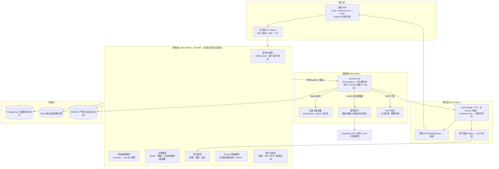
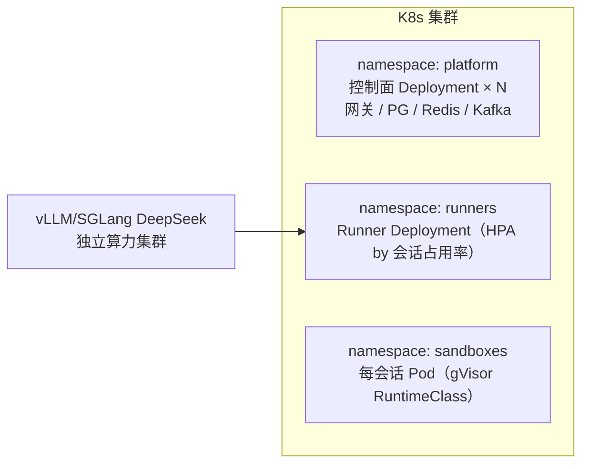

# 企业级 Agent 平台（基于 DeepSeek Harness）· 技术方案

> 版本：v1.0（2026-11-17）· 配套《01-产品方案.md》
> 阅读对象：架构师、后端、前端、Infra。本文给出总体架构、核心决策（ADR）、模块设计、数据模型、接口契约、迁移映射与风险对策。

---

## 〇、技术事实底座（调研结论，先对齐认知）

DeepSeek Harness（dsh，`github.com/deepseek-ai/deepseek-harness`，MIT，Developer Preview v0.1）的关键技术事实，本方案全部建立其上：

| 事实 | 工程含义 |
|---|---|
| Node.js/TypeScript 运行时；`npx @deepseek-ai/dsh web` 起 Web UI（默认 3080）；存在 **headless profile** | 服务端以 headless 形态把 dsh 当"执行内核"嵌入，不依赖其 Web UI |
| 基于 **Cordis** 元框架：插件树，注册副作用在卸载时自动回滚；插件靠 Service + 类型化事件协作 | 平台能力 = 挂插件 + 写 patch；热更新不炸会话 |
| 扩展点：`ctx.llm`（模型适配器）、`ctx.tools`（工具注册）、`ctx.shell`（shell 后端）、`ctx.fs`（文件系统 provider / `fs/*` 事件）、`ctx.sandbox`（进程约束）、`ctx.commands`、`ctx.jobs`（后台任务）、`ctx.agents` + `session/event`（UI/事件流）、`agent/*` 与 `tools/*` 事件瀑布（拦截请求/工具/轮次） | 平台自研插件的挂载点全部有官方出处，不靠 monkey-patch |
| 核心包：`core/session`（append-only 会话日志）、`core/system-prompt`、`core/tools`（工具注册 + 带门控的执行管道 gated pipeline）、`core/agent(-loop)`、`llm/llm` | 审计、回放、审批都有原生抓手 |
| **Session Log 运行时不变量**：到达模型请求的一切必须可从日志重建；resume/fork/retrieval/replay 共用同一事件流 | 审计/回放/跨节点续聊的"免费午餐" |
| 配置四层叠加：profile 内 bundles → profile patch → home patch → CLI `--patch`；`dsh --profile web --dump-config` 可导出最终配置 | "场景 = 一份可复现的配置装配"有原生机制 |
| 四种运行模式：Standard / **PTC**（模型写代码编排多轮工具调用）/ Minimal / **Creative**（内存里试装插件、组合新模式） | 产品模式的直接映射；Creative 模式是"AI 生成场景"的引擎 |
| 模型无关：默认适配器讲 OpenAI chat-completions 协议，任意兼容端点可接；DeepSeek V4 Pro 一等公民 | 模型网关一个适配器收口 |
| 官方明示：preview 期**有破坏性变更** | 版本 pin + 契约测试 + 内核抽象（见 ADR-1） |

---

## 一、总体架构：控制面 / 数据面 / 事件面 三平面分离



**为什么要三平面分离**：

1. dsh 是**单用户/本地优先**设计的 harness——多租户、SSO、配额、审计这些"企业ilogging"一层不存在，这正是控制面要补的，也是平台的价值所在，而不是 dsh 的短板；
2. dsh preview 期接口会变——控制面**只认自己的抽象**，与 dsh 的接触面收敛到 Runner 内的一组适配插件（见 ADR-1）；
3. Event Plane 单独抽出，是因为 dsh 的 session/event 流同时服务三个消费者：**前端实时渲染、审计管道、计量**——一进三出，用桥接器扇出。

---

## 二、核心架构决策（ADR）

### ADR-1：永不 fork dsh，执行内核抽象为 `AgentKernel` 端口

- 平台对企业能力的实现**只允许三种形式**：Cordis 插件、profile/bundle/patch 配置、控制面服务。改 dsh 源码一行都不允许（升级即冲突，官方明示有 breaking changes）。
- Runner 服务对控制面暴露的是平台自定义的 `AgentKernel` gRPC/HTTP 接口（createSession / sendTurn / streamEvents / approve / fork / getTrajectory / cancel），dsh 是其**第一个实现**。备选实现接口预留（deepagents / Hermes Agent），对冲 preview 风险——若 dsh 某版本破坏性变更无法短期适配，可切换备选内核保核心业务。
- dsh 版本**显式 pin**（package-lock + 内部 npm registry 镜像），升级走"契约测试 → 灰度 Runner 池 → 全量"三步（见 §11 风险）。

### ADR-2：场景 = Bundle（不可变配置快照），会话启动时锁定版本

- 场景在控制面编译为 Bundle：`profilePatch` + `pluginMounts`（插件@精确版本）+ `systemPromptSections` + `skillFiles` + `mcpConfig`（含认证引用）+ `policyRef` + `modelRoute` + `inputSchema`。
- **会话开始时把 Bundle 快照钉进 session 记录**——场景后续改版不影响进行中的会话（审计与复现的硬要求）；回放/fork 永远用会话自己的快照。
- prompt 分区沿用 dsh `core/system-prompt` 的分区机制，替代旧方案的 `system_prompt append` 拼装。

### ADR-3：Session Log 是审计、回放、计量、评测的唯一事实源

- Runner 内挂 `audit-exporter` 插件：tap `session/event` 流，全量事件 → Kafka →（PG 建索引 + S3 存原文，WORM 留存策略）。
- 因为 dsh 有"一切可重建"不变量，**回放不是回放录像，是从日志真实重建模型请求**——监管审计可直接出具。
- 计量不从模型网关单一来源取（网关只见 token），工具调用数、轮次、人工干预等从事件流计算，两者在审计管道对账。

### ADR-4：模型访问只有一个出口——企业模型网关

- Runner 内只注册一个 `ctx.llm` 适配器（`ent-llm-gateway`），指向模型网关；场景里的"模型"字段只是路由标签。
- 网关职责：统一鉴权（租户级密钥不落 Runner）、**计量**（输入/输出/缓存 token 分账）、**路由策略**（场景绑定 → 租户强制私有化 → 成本降级链）、**故障降级**（超时/限流切备用模型并记录事件）。
- DeepSeek 侧要点：复杂场景用 `deepseek-chat`（V3.2+）**thinking + tool-use** 模式；简单场景用非思考模式省钱；私有化集群以 OpenAI 兼容端点注册为最高优先级。V4 Pro API 参数（thinking budget 等）的透传收敛在网关与适配器两处，不进业务代码。
- 实现选型：**MVP 用 LiteLLM Proxy**（自带预算/重试/fallback/支出追踪）前置一层自研薄策略层写入 `usage_record`；V1 后视计量深度需求决定是否替换为全自研网关。

### ADR-5：代码执行永远不进 Runner 容器——沙箱是独立 provider

- dsh 的 seam 设计中 fs 与 process 共享"执行世界"，换一个 provider 所有工具整体切换。平台提供 `ctx.sandbox` + `ctx.shell` + `ctx.fs` 的**远程沙箱后端**：Runner 内的工具调用全部转发到**每会话一个的沙箱容器**（gVisor/Kata 隔离，egress 代理白名单：默认仅企业内网 + 授权 MCP + 模型网关）。
- Runner 容器本身**无 shell 能力**（最小镜像、只读根 fs），即使提示词注入诱导模型执行恶意命令，爆炸半径也被限制在一次性沙箱内。
- 这比旧 AgentX 的 `read_guard/write_guard`（保守正则拦 Bash，承认拦不住 `python3 -c "..."`）是**代际升级**：从"文本识别危险"变成"执行环境隔离 + 网络白名单"，正则拦截仍保留为工具层策略的第一道。
- 沙箱产物通过 workspace 卷 + 检查点事件同步到 S3（支撑跨 Runner 恢复，见 ADR-6）。

### ADR-6：多 Runner 扩缩容靠"亲和路由 + 日志水合"

- 会话与 dsh 进程内状态绑定（插件树在进程内），所以：Redis 路由表 `session_id → runner_id` 保证亲和；每个 Runner 承载 N 个并发会话（容量压测定基线，初值 N=20）。
- 跨节点恢复 = **水合（hydrate）**：会话日志是 append-only 且可重建模型上下文，workspace 产物在 S3 有检查点——新 Runner 拉起后用 `resume` 等价机制从日志 + 产物重建会话（dsh 的 resume/fork/replay 本来就共用同一事件流）。
- 空闲回收沿用旧 ClientPool 思想（默认空闲 1800s 回收），但回收 ≠ 丢失：日志与产物已归档，下次唤醒重新水合。HPA 指标用"Runner 会话占用率"，不用 CPU。

### ADR-7：审批走"门控管道 + 平台回调"，不回填补丁

- dsh `core/tools` 的执行管道是**带门控的（gated）**，且有 `tools/*` 事件瀑布可拦截——审批桥插件 `approval-bridge` 在门控处挂起工具调用 → 回调控制面审批服务 → SSE 推前端 / IM → 人决策 → 放行或拒绝，超时（默认 600s，可配）自动 deny。
- 语义完全对齐旧 ApprovalManager（approve / deny / 带参提交 / 选择题），前端交互平移。
- "何时必须审批"由治理策略决定（工具 × 场景 × 数据敏感度矩阵），策略下发到 Runner 的 `policy` 插件本地判定，**不逐次问控制面**（性能），但判定结果全部写事件流（审计）。

### ADR-8：控制面复用 FastAPI，Runner 侧用 TypeScript——双栈边界清晰

- 控制面沿用旧平台 FastAPI 分层规范（schema → route → service，ResponseUtil 统一响应），团队零学习成本，登录态/RBAC/组织等资产直接复用。
- dsh 是 TS 生态，Runner 适配层与平台插件必然是 TS。**边界约定：控制面与 Runner 之间只走 `AgentKernel` 协议（protobuf/JSON），进程内不出现跨语言调用**。团队需要 1–2 名 TS 工程师维护 Runner 侧（见 §12 人力）。

---

## 三、平台自研插件清单（Runner 侧，全部挂载到官方扩展点）

| 插件 | 扩展点 | 职责 | 替代的旧 AgentX 组件 |
|---|---|---|---|
| `ent-llm-gateway` | `ctx.llm` | 唯一模型适配器，指向模型网关；透传 thinking 参数 | `env` 注入 `ANTHROPIC_BASE_URL/MODEL`、`_resolve_runtime_model` |
| `policy`（工具/FS 策略） | `tools/*`、`fs/*` 事件 | 允许/需审批/拒绝三级判定；读写路径白名单；危险命令正则（第一道） | `hooks/read_guard.py`、`write_guard.py` |
| `approval-bridge` | `core/tools` 门控管道 | 挂起待审批工具调用，等待控制面回调 | `approval_manager.py` |
| `sandbox-remote` | `ctx.sandbox` / `ctx.shell` / `ctx.fs` | 把执行世界切换到每会话沙箱容器 | `workspace_mode` 三模式的进程内实现 |
| `audit-exporter` | `session/event` | 事件流扇出到 Kafka；同时驱动 Runner 内 metrics | PG transcript 镜像（`session_store.py`）的升维替代 |
| `dlp-redactor` | `tools/*`（工具结果入模型前）+ Event Bridge（出向用户流）+ 管道入库时 | 三级脱敏：凭据/PII/内网信息；流式代码块截断 | `security/redactor.py`、`code_truncator.py` |
| `mcp-auth-resolver` | MCP 工具注册 + 调用时 | 每请求注入登录态/短期令牌（KMS/Vault 取），不落配置 | `MCPRuntimeAuthResolver` |
| `ent-storage` | dsh 存储插件 seam | 会话日志检查点 → S3；产物归档；跨 Runner 水合读取 | `PostgresSessionStore` |
| `scenario-bootstrap` | profile patch | 会话启动时应用 Bundle：prompt 分区、skill 物化、模式选择（Standard/PTC） | `OptionsBuilder`、`_build_options_input`、`skill_materializer` |
| `metrics` | `agent/*`、`llm` 流事件 | OTel span + Prometheus 指标（TTFT、轮次、工具耗时） | 旧方案零散埋点 |

**插件工程纪律**（对齐 Cordis/官方插件三原则 + 企业加码）：

1. 副作用可回滚（卸载即清场）；不窃改其他插件内部状态，协作走 service/event；
2. 全部插件进**内部插件注册表**：签名 + 版本 pin + 安全扫描；Runner 镜像只内置审核通过的插件（MVP 不做运行动态安装，V1 从内部市场动态挂 out-of-tree 插件）；
3. 每个插件声明权限用途（需要什么 ctx 能力、访问什么网络），上架审查必查。

---

## 四、Runner 服务详细设计

### 4.1 进程模型

```
Runner Pod（K8s Deployment，多副本）
└── node runner-server
      ├── AgentKernel Server（gRPC/HTTP，控制面唯一入口）
      ├── dsh headless 实例（Cordis 插件树）
      │     ├── 平台插件包（§三 10 个插件）
      │     └── dsh 官方插件（工具/子代理/jobs…）
      ├── SessionRegistry：session_id ↔ dsh session，容量上限 N
      └── Bundle 校验器：验签 + 版本白名单，拒绝不在注册表的插件/策略
```

- **一个 Runner 进程一棵插件树、多会话**（dsh 的 web profile 本身就是多会话模型）；会话间隔离靠：会话级工作区（沙箱容器隔离）、会话级 Bundle 快照、会话级 asyncio 等价锁（每个 session 一把锁串行化 turn，沿用旧设计）。
- **能力签名热切换**沿用旧 `build_capability_signature` 思想但大幅简化：Bundle 不可变 ⇒ 同会话内能力不变（换能力 = 新会话），签名只需校验 Bundle hash。

### 4.2 生命周期状态机

`creating → hydrating(可选) → active → idle → archived → (rehydrating) → active`，归档与删除由 TTL + 租户留存策略驱动；`finished/aborted` 为终态，只读回放。

### 4.3 事件桥（Event Bridge）协议

沿用旧 SSE 事件协议**降低前端改造成本**，字段从 dsh `session/event` 映射：

| 平台 SSE 事件 | 来源（dsh） | 说明 |
|---|---|---|
| `session` | session 元数据 | session_id / bundle 版本 / workspace |
| `message_delta` / `message` | `llm` 流事件 | 正文增量（过桥时过 dlp-redactor） |
| `thinking_delta`（可选折叠） | `llm` thinking 流 | 按模型 CoT 展示策略默认折叠 |
| `tool_use_start/delta/stop`、`tool_result` | `tools/*` 事件 | 工具卡片；含审批门控状态 |
| `subagent_dispatch` | `agent/*` 事件 | 子代理派发（旧协议没有，前端新增卡片） |
| `approval_required/resolved` | `approval-bridge` | 同旧语义 |
| `cost_tick` | `metrics` 插件 | 实时 token/成本 |
| `files` / `done` / `error` | workspace 检查点 / turn 结束 | 产物与收尾 |

审计管道与 SSE 消费**同一条已脱敏事件流**，保证"用户看到的、模型看到的、审计留的"三者一致（dsh 不变量加持）。

---

## 五、场景装配器（控制面）

旧 `_build_options_input`（1600 行服务里的翻译器）的正式继承者，独立为 `ScenarioAssembler`：

```python
# 控制面：scenario_version → Bundle（伪代码）
def compile(scenario: ScenarioVersion, tenant: Tenant) -> Bundle:
    return Bundle(
        profile_patch={
            "mode": scenario.execution_mode,          # standard / ptc
            "plugins": resolve_plugins(scenario),      # 仅注册表白名单内
            "systemPrompt": PromptSections(            # dsh 分区，替代 append 拼装
                identity=platform_identity(),
                domain=scenario.prompt_template,        # {{变量}} 渲染后
                safety=tenant.safety_rules,
                workspace=workspace_rules(scenario),
            ),
        },
        skill_files=materialize_skills(scenario.skill_ids),     # 沿用 skill_materializer 逻辑
        mcp=resolve_mcp(scenario.mcp_server_ids),               # 引用认证托管，不内联密钥
        model_route=ModelRoute(primary=scenario.model, fallbacks=tenant.fallback_chain),
        policy=compile_policy(tenant, scenario),                # 工具×敏感度矩阵快照
        input_schema=scenario.input_schema,
    )
```

- **AI 生成场景**：`POST /api/agent-scenarios/generate` 不再"拼 prompt 调模型"，而是创建一个临时的 dsh **Creative 模式**会话：把工作描述 + 当前能力目录喂进去，让它在内存中试装插件、验证组合，产出 Bundle 草稿回传前端抽屉（「AI 建议」标记不变）。生成后**必须试运行成功一次才可保存**（质量红线）。
- 数据落地沿用旧方案骨架：`scenario` 表 + `scenario_version` 表（v1 起版本不可变），官方场景仍可为 seed 数据随版本发布。

---

## 六、数据模型（控制面，新增/变更表）

| 表 | 关键字段 | 说明 |
|---|---|---|
| `tenant` / `department` / `user` | — | 沿用旧平台，补 `tenant.policy_json`、`tenant.quota_policy` |
| `agent_scenario` | id, tenant_id, space(official/personal/team), owner_id, name, icon, description, status(draft/review/published), current_version | 空间三级 |
| `agent_scenario_version` | id, scenario_id, version, bundle_json, change_log, created_by, created_at | **不可变**；发布/回滚即切换 `current_version` |
| `agent_session` | id, tenant_id, user_id, scenario_id, scenario_version, runner_id, status, workspace_uri, bundle_hash, tokens_in/out/cache, cost, started_at/ended_at | 亲和路由 + 计量汇总 |
| `session_event_index` | session_id, seq, source(system/llm/tools/agent/ui), kind, ts, payload_uri(S3), redacted | 事件索引；原文在 S3 WORM 桶 |
| `approval_ticket` | id, session_id, tool_call_id, tool, args_digest, channel(ui/feishu/dingtalk), status, decided_by/at, timeout_at | 审批留痕 |
| `plugin_registry` | id, package, version, extension_points, permissions, audit_status, signature | 白名单注册表 |
| `skill` / `mcp_server` | — | 沿用旧表，补 `version`、`auth_ref` |
| `model_registry` | id, name, provider(deepseek-api/private-vllm/…), endpoint_ref, modes(thinking/non), price_in/out/cache | 目录 |
| `model_route_policy` | tenant_id, rules_json（强制私有化/降级链/场景绑定优先级） | 路由策略 |
| `usage_record` | session_id, model, tokens_in/out/cache_hit, cost, ts | 与网关对账，成本分摊数据源 |
| `quota_ledger` | scope(tenant/dept/user), scope_id, period, limit, consumed | 三级配额 |
| `audit_export` | id, requester, session_range, uri, expires_at | 审计导出工单 |

---

## 七、控制面 API（沿用 ResponseUtil / ApiResponse[T] 规范，节选）

| 方法 | 路径 | 说明 |
|---|---|---|
| GET/POST/PUT/DELETE | `/api/agent-scenarios[/…]` | 场景 CRUD；`/generate` AI 生成草稿；`/:id/publish` 上架审批（V1）；`/:id/run-test` 试运行 |
| POST | `/api/agent/sessions` | 建会话（body: scenario_id, input）；返回 session_id 与路由 |
| POST | `/api/agent/sessions/{id}/stream` | SSE 执行一轮（沿用旧 `/conversations/stream` 语义） |
| POST | `/api/agent/sessions/{id}/interrupt` `/fork` `/replay` | 中断 / 分叉 / 回放 |
| GET | `/api/agent/sessions/{id}/trajectory?source=tools` | 轨迹查询（分页从事件索引取） |
| POST | `/api/agent/approvals/{ticket_id}/resolve` | 审批决策回调入口（UI/IM 共用） |
| GET | `/api/audit/sessions` `/api/audit/export` | 审计检索与导出工单 |
| GET/PUT | `/api/governance/policies` `/quotas` `/model-routes` | 治理配置 |
| GET | `/api/registry/plugins` `/skills` `/mcp-servers` `/models` | 能力目录（前端场景编辑器数据源，沿用旧能力目录思想） |

---

## 八、安全设计（分层，从最外到最里）

| 层 | 措施 |
|---|---|
| 接入 | 企业网关 TLS + WAF；OIDC SSO；Runner 永不直接暴露公网（仅控制面可达） |
| 控制面 | RBAC 全接口鉴权；Bundle 签名与注册表校验；所有写操作审计事件 |
| Runner | 最小镜像、无 shell、只读根 fs；env 白名单（沿用旧 `_ALLOWED_ENV_KEYS` 思想，密钥只经 `mcp-auth-resolver`/`ent-llm-gateway` 按需短期注入）；插件白名单 |
| 执行 | 每会话独立沙箱容器（gVisor）；egress 白名单代理；工具三级策略 + 审批矩阵；危险命令正则兜底 |
| 数据 | 事件流三级脱敏（入模型前/出向用户/入库前）；S3 WORM 桶 + KMS 加密；审计回放页水印与访问审批；会话日志留存期按租户可配 |
| 模型 | 模型网关统一出口；租户可强制"仅私有化端点"；外部兜底模型需显式授权场景 |
| 提示词注入 | 工具结果视为非可信数据（dsh 提示词分区里固化安全规则）；高危工具调用与"检索内容驱动的指令"隔离审批（V1：间接注入扫描插件评估引入） |

---

## 九、可观测性与质量运营

- **指标**（`metrics` 插件 → Prometheus）：执行成功率、TTFT、每任务轮次/工具调用数、缓存命中率、人工干预率、单任务成本；按 租户/场景版本/模型 三维切片。
- **追踪**：OTel span（turn → llm call → tool call → sandbox exec），trace_id 贯穿控制面/Runner/网关；可选对接 Langfuse。
- **质量回归**：从审计回放抽样构建评测集，场景改版先在 replay 评测集回归（旧方案没有的能力， Session Log 不变量直接给的）——这是 P2「场景质量自动评估」的地基。

---

## 十、部署架构



- **私有化交付**：全栈（含模型）可单机版（all-in-one compose，PoC/小型客户）与集群版（Helm Chart）两种形态；信创环境适配 x86/ARM 双镜像。
- **租户隔离三档**：共享 Runner（默认）→ 专属 Runner 池（大租户）→ 专属集群（金融/政企）。
- 模型侧：DeepSeek 官方 API（试用期 3M token 活动可作灰度流量）与企业私有集群并存，网关按租户策略切换。

---

## 十一、风险与对策

| 风险 | 等级 | 对策 |
|---|---|---|
| **dsh preview 破坏性变更** | 高 | 版本 pin + 内部 npm 镜像；插件 API **契约测试套件**进 CI（每个扩展点一条用例）；内核抽象端口（ADR-1）保留 deepagents/Hermes 备选实现；升级窗口跟随官方月度节奏，先灰度池后全量 |
| 单进程插件树的横向扩展 | 中高 | ADR-6 亲和路由 + 日志水合；Runner 会话上限 N 经压测校准；大租户专属池 |
| 团队 TS 能力不足（后端为 Python 栈） | 中 | 双栈边界（ADR-8）；Runner 侧 1–2 名 TS；插件模板 + cookbook 内化；前 2 周安排 dsh/Cordis 源码深读 POC |
| 会话日志含敏感数据（CoT/工具出参） | 中 | 加密 + WORM + 留存策略 + 回放访问审批；脱敏三级里"入库前"一级专为此设 |
| 社区插件供应链攻击 | 中 | MVP 仅镜像内置白名单插件；V1 市场动态挂载要签名 + 扫描 + 沙箱试运行审核 |
| thinking 模式成本失控 | 低 | 场景默认非思考模式；三级配额 + 成本超限降级链（ADR-4） |
| 审核/合规口径变化 | 低 | 策略全部配置化下发（policy 插件），不改代码 |

---

## 十二、里程碑与人力

> 建议团队 6–7 人：FastAPI 后端 ×2、TS（Runner/插件）×1–2、前端 ×2、架构 0.5、QA 0.5（可兼）。

| 里程碑 | 周期 | 交付 |
|---|---|---|
| **M0 技术验证** | 2 周 | dsh 深读 + POC：headless 起内核；写通 3 个刺探插件（llm 网关适配 / tools 拦截 / session-event 扇出）；验证 fork/replay；验证 OpenAI 兼容端点接私有 vLLM；单 Runner 20 并发会话压测。产出《POC 报告》与最终 ADR 确认 |
| **M1 骨架贯通** | 3 周 | 控制面（SSO/RBAC/场景 CRUD/generate/装配器）+ Runner 服务（建会话/执行/事件桥 SSE）+ 前端 AgentChat 平移（对话/工具卡/审批弹窗）；官方场景 5 个 seed |
| **M2 治理加固** | 3 周 | 沙箱 provider、approval-bridge、policy、dlp、audit 归档 + 轨迹回放页、配额计量对账；私有化模型端点接入 |
| **M3 MVP 验收** | 2 周 | 试运行-保存流、成本报表基础版、压测与红队（注入/越权/逃逸用例）、《上线检查单》 |
| **V1** | +8 周 | 团队空间与上架审批、场景版本化、知识库插件（RAG）、ctx.jobs 定时任务、内部插件市场、IM 审批、成本分摊报表 |
| **V2** | +8 周 | PTC 批量产品化、子代理场景化编排、replay 评测驱动场景优化、备选内核通道演练 |

---

## 十三、从 AgentX（Claude SDK）到本平台的迁移映射总表

| 旧组件（文件级） | 去向 | 新载体 |
|---|---|---|
| `client/session_client.py` / `client_pool.py` 常驻 SDK 进程池 | 替代 | Runner 池 + SessionRegistry + 空闲回收（ADR-6） |
| `options_builder.py`（OptionsInput → ClaudeAgentOptions） | 替代 | `ScenarioAssembler`（Scenario → Bundle/profile patch，ADR-2） |
| `_build_options_input()` 场景翻译 | 升级 | 同上，`system_prompt append` → dsh prompt 分区 |
| `hooks/read_guard.py` / `write_guard.py` 读写白名单 | 替代+升维 | `sandbox-remote`（隔离执行世界）+ `policy` 插件（ADR-5） |
| `approval_manager.py` | 语义平移 | `approval-bridge` 插件 + `approval_ticket` 表（ADR-7） |
| `security/redactor.py` / `code_truncator.py` | 升级 | `dlp-redactor` 三级脱敏 |
| `session_store.py`（PG transcript 镜像） | 替代 | `audit-exporter` + `ent-storage`（dsh 原生 Session Log，事件流即 transcript） |
| `mcp_mapper.py` / MCP 动态认证 | 平移+升级 | MCP 网关 + `mcp-auth-resolver` 插件 |
| `skill_materializer.py` | 平移 | `scenario-bootstrap` 插件（物化到沙箱工作区） |
| `event_mapper.py` + SSE 协议 | 平移 | Event Bridge 协议映射（§4.3），前端渲染层改动最小 |
| `execution_limiter.py` 并发限制 | 升级 | Runner 容量 N + HPA + 配额系统（不止限流，还能计量） |
| 复核模式 `_run_review_turn` | 平移 | 控制面编排：两个会话/子代理，执行与复核可用不同模型路由 |
| 场景 `generate` 接口 | 引擎升级 | Creative 模式会话生成并验证 Bundle |
| 前端 `ClaudeChat.vue` / `ClaudeInputPanel.vue` / `claude-scenarios.ts` | 平移+扩展 | `AgentChat.vue`，场景选择器三级分组，新增轨迹视图与子代理卡片 |
| `agent-builder/`（LangGraph 可视化编排） | 不动 | 继续独立演进；确定性编排诉求归它，本平台不接 |

**一句话总结技术路线**：把旧平台里"为补 Claude Code 黑盒而手搓的治理件"，全部换成 dsh 原生的插件挂载点与 Session Log 不变量；把团队已经打磨好的产品思想（场景=能力声明+prompt、AI 生成、复核、审批）原样平移到控制面；控制面复用 FastAPI，执行面交给 dsh，中间用 `AgentKernel` 端口解耦——**企业价值全部沉淀在自己的控制面与插件资产里，而不是押注在某个 preview 版本的内核上。**
