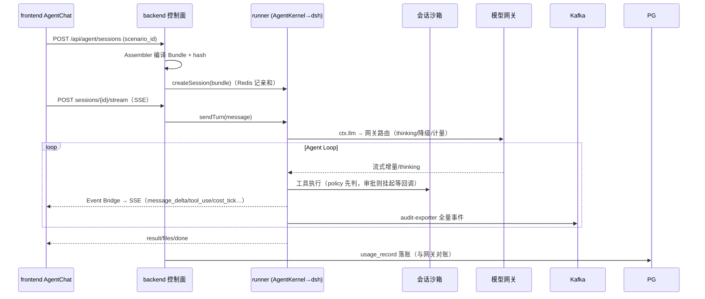

# 03 · 后端架构分析（backend + runner）

> 项目：AgentHarness Forge · 配套《02-技术方案.md》。本文把"后端"拆清楚：**控制面（Python/FastAPI）+ 执行内核适配层（TypeScript/Runner）**，两者分属本仓库的 `backend/` 与 `runner/` 两个目录。

## 一、为什么后端是两个子工程

| 子工程 | 语言 | 原因 |
|---|---|---|
| `backend/` 控制面 | Python 3.12 + FastAPI | 复用团队既有资产：分层规范（schema → route → service）、ResponseUtil、登录态/RBAC/组织体系；企业治理逻辑密集，FastAPI 生态最顺手 |
| `runner/` 执行内核适配层 | Node.js 20+ / TypeScript | DeepSeek Harness（dsh）与 Cordis 插件生态是 TS 的；所有贴着 dsh 的代码（AgentKernel 实现、平台插件）必须在 TS 侧 |

**边界纪律（ADR-8）**：两进程间只走 `AgentKernel` 协议（HTTP/JSON 命令 + 事件回推），进程内无跨语言调用。控制面**不认识** dsh/Cordis 的任何类型——这是隔离 dsh preview 破坏性变更的防火墙。

```
┌────────────┐  HTTP /v1/sessions…  ┌─────────────┐  进程内   ┌──────────────┐
│  backend/  │ ───────────────────► │   runner/   │ ────────► │ dsh headless │
│  FastAPI   │ ◄─────────────────── │ AgentKernel │  插件树    │ (Cordis)     │
│  控制面     │  approval 回调/事件扇出 │  TS 适配层   │           │              │
└────────────┘                      └─────────────┘           └──────────────┘
```

## 二、backend/ 目录结构与分层规范

```
backend/
├── pyproject.toml                  # uv/pip 双兼容；Python 3.12
├── .env.example
└── src/api/
    ├── main.py                     # FastAPI 工厂：中间件 → 路由注册 → 生命周期
    ├── core/
    │   ├── config.py               # pydantic-settings：DB/Redis/S3/RUNNER/网关地址
    │   └── database.py             # SQLAlchemy 2.0 async engine + session
    ├── utils/
    │   └── response.py             # ResponseUtil（沿用旧平台 ApiResponse[T] 契约）
    ├── models/                     # SQLAlchemy 2.0 typed 模型（见 02-技术方案 §六）
    │   ├── agent_scenario.py       # 场景 + 不可变版本（space 三级）
    │   ├── agent_session.py        # 会话（runner_id 亲和 / bundle_hash / 计量汇总）
    │   ├── approval_ticket.py      # 审批工单
    │   └── registry.py             # 插件/技能/MCP/模型 注册表与路由策略
    ├── schemas/                    # Pydantic 请求/响应契约，与前端 types 对齐
    ├── services/                   # 业务编排层
    │   ├── scenario_service.py     # 场景 CRUD / generate（调 Creative 会话）/ 试运行
    │   ├── scenario_assembler.py   # ★ Scenario → Bundle 编译器（旧 _build_options_input 的继承者）
    │   ├── session_service.py      # 会话生命周期 + Runner 亲和调度
    │   └── runner_client.py        # ★ 控制面 → Runner 的唯一出口（httpx + 重试 + 熔断）
    └── routes/                     # 仅做：鉴权 → 参数解析 → service → ResponseUtil 包装
        ├── agent_scenario.py
        ├── agent_session.py        # 含 SSE stream 端点
        ├── approval.py             # 审批 resolve 回调（UI/IM 共用）
        ├── audit.py                # 轨迹检索/回放/导出
        ├── registry.py             # 能力目录（前端场景编辑器数据源）
        └── governance.py           # 策略/配额/模型路由
```

规范沿袭旧平台：**route 不写业务、service 不碰 HTTP、model 不做序列化**；统一 `ResponseUtil.ok()/fail()`；所有写操作进审计事件。

## 三、核心服务设计要点

### 3.1 ScenarioAssembler（场景装配器）

- 输入：`agent_scenario_version` + 租户策略；输出：**不可变 Bundle**（见 02-技术方案 ADR-2）。
- 关键职责：能力目录解析（skill/mcp 名称 → id，沿用旧 `resolveClaudeScenarioSelection` 的服务端版）、prompt 分区组装（identity/domain/safety/workspace 四区，替代旧 `system_prompt append`）、策略快照编译、模型路由解析。
- Bundle 计算 SHA-256 作为 `bundle_hash` 写入会话——回放/审计/复现的锚点。

### 3.2 SessionService + Runner 亲和调度

- Redis 路由表：`session_id → {runner_id, endpoint}`；新建会话按"租户隔离档 → Runner 会话占用率最低"选 Runner。
- 会话状态机：`creating → hydrating? → active → idle → archived（可 rehydrate）→ finished/aborted`。
- 空闲回收（默认 1800s 扫描/300s）沿用旧 ClientPool 参数，但回收 = 归档不丢失（Session Log + workspace 检查点已落 S3）。

### 3.3 RunnerClient（协议客户端）

| 方法 | 说明 |
|---|---|
| `createSession(bundle, user_ctx)` | 下发 Bundle 快照，Runner 验签后 `hydrate` |
| `sendTurn(session_id, message, opts)` | 发起一轮；返回 turn_id；事件经 Event Bridge 扇出 |
| `interrupt / fork / replay(session_id, at_seq?)` | 会话控制；fork/replay 锚定事件序号 |
| `resolveApproval(session_id, ticket_id, decision)` | 审批决策透传 |
| `getTrajectory(session_id, source?, cursor?)` | 轨迹分页（审计/前端轨迹面板共用） |

MVP 用 HTTP/JSON + 连接池；事件通道由 Runner 侧 Event Bridge 直推 SSE 网关（不经控制面中转，降延迟）。

## 四、runner/ 目录结构（TypeScript 侧）

```
runner/
├── package.json                    # 依赖：cordis、@deepseek-ai/dsh（内部镜像 pin 版本）
├── tsconfig.json
└── src/
    ├── server.ts                   # HTTP server（Fastify）：/v1/* → SessionKernel
    ├── kernel/                     # （已按实现更新）
    │   ├── types.ts                # 对外数据形状：KernelEvent、SessionHandle
    │   ├── manifest.ts             # ★ 会话清单（类型由 contracts/session-manifest.schema.json 生成）
    │   ├── session-kernel.ts       # 会话、回合、执行日志、审批、容量；与引擎无关，只产出 RuntimePlan
    │   ├── journal.ts              # 每会话执行日志：持久事件带序号落盘，控制面回执后清理
    │   └── dsh/                    # ★ DSH 适配层：dsh 相关代码只在这里（process / protocol / runtime-config / engine）
    └── plugins/                    # 平台自研 Cordis 插件（02-技术方案 §三 完整清单）
        ├── ent-llm-gateway.ts      # ctx.llm：唯一模型出口 → 企业模型网关
        ├── policy.ts               # tools/* + fs/* 拦截：三级策略判定（本地快照判定）
        ├── approval-bridge.ts      # 门控管道挂起 → 回调控制面 → 等待决策（超时 deny）
        ├── audit-exporter.ts       # session/event → Kafka 扇出（审计唯一事实源）
        ├── dlp-redactor.ts         # 入模型前/出向用户/入库前 三级脱敏 + 代码块截断
        ├── mcp-auth-resolver.ts    # 调用时注入短期令牌（KMS 取），不落配置
        ├── ent-storage.ts          # Session Log 检查点 + workspace 产物 → S3；水合读取
        ├── sandbox-remote.ts       # ctx.sandbox/shell/fs provider → 每会话沙箱容器
        ├── scenario-bootstrap.ts   # 应用 Bundle：prompt 分区/技能物化/模式(standard|ptc)
        └── metrics.ts              # OTel span + Prometheus（TTFT/轮次/工具耗时）
```

### 插件最小形态（Cordis 约定，官方手册 Chapter 20）

```ts
// runner/src/plugins/policy.ts 的骨架形态
export const name = 'forge-policy'

export function apply(ctx: Context, config: PolicySnapshot) {
  // 注册即副作用，卸载自动回滚 —— 平台插件三条铁律见 02-技术方案 §三
  ctx.on('tools/before-execute', async (call) => { /* allow | need-approval | deny */ })
}
```

### Runner 守护约束

- 镜像内置全部白名单插件，**运行期不装包**（MVP 红线）；
- 容器无 shell、只读根 fs、env 白名单；
- Bundle 校验：签名 + 插件版本白名单 + 策略引用存在性，三者缺一拒建会话。

## 五、端到端执行链路（一次任务）



## 六、工程化与测试策略

| 维度 | backend | runner |
|---|---|---|
| 包管理 | uv（pyproject） | pnpm（内部 npm 镜像，lock 文件入库） |
| Lint/类型 | ruff + mypy(strict-ish) | eslint + tsc --strict |
| 单测 | pytest（service 层打桩 RunnerClient） | vitest（插件行为级：挂载→注册→卸载回滚断言） |
| 契约测试 | — | **dsh-plugin-contract 套件**：每个扩展点一条用例，dsh 升级 CI 必跑（ADR-1 风险阀门） |
| 集成 | testcontainers 起 PG/Redis + mock runner | docker compose 起 dsh + 假网关 |
| 配置 | pydantic-settings，env 注入 | dsh profile patch + env |

## 七、从旧 AgentX 后端的迁移窗口

| 旧模块 | 落点 | 动作 |
|---|---|---|
| `services/claude_agent_service.py`（1600 行编排） | `scenario_assembler.py` + `session_service.py` | **拆解重写**（旧文件是翻译器+编排器混合体，新架构里两者分离） |
| `claude_agent/` 核心层整体 | `runner/` | 废弃重写（SDK 特有逻辑无平移价值，思想已吸收进 ADR） |
| `ResponseUtil` / 登录态 / prompt 模块范式 | `utils/` + `core/` | 直接搬运 |
| MCP 目录与动态认证表结构 | `models/registry.py` + `mcp-auth-resolver` 插件 | 表结构平移，机制升级为插件 |
